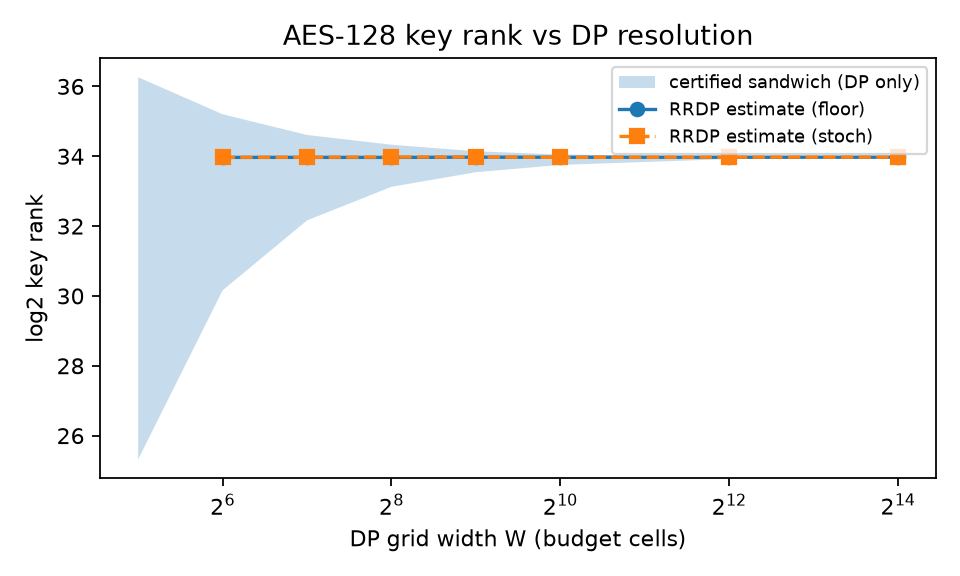

# Problem 9: Randomized Rounding in Dynamic Programming

**Round, Count, Correct: an FPRAS for side-channel key rank**
Team Members:
- Aarush Mohan Mathur (2410110391)
- Ojasw Kant (2410110226)
- Breeti Bandyopadhyay (2410110105)
- Ishaan Prakash (2410110429)
- Shaurya Ajit Singh (2410110318)

This project looks at what you get by combining **rounding**, **dynamic programming** and **randomization**, using one concrete, #P-hard problem: estimating the **key rank** after a side-channel attack. The result is **RRDP-Rank**, an algorithm that:

1. rounds the per-subkey scores to a coarse grid,
2. counts the rounded instance exactly with a DP, which gives **certified bounds** `L ≤ rank ≤ U`, and
3. samples uniformly from the DP and applies rejection sampling, which gives an **unbiased `(1 ± ε)` estimate** of the true rank.

The full write-up, with all proofs, is in [`report/report.pdf`](report/report.pdf) (12 pages).

---

## Table of contents
- [The problem](#the-problem)
- [The algorithm](#the-algorithm-rrdp-rank)
- [Main results](#main-results)
- [Experimental results](#experimental-results)
- [Repository layout](#repository-layout)
- [Getting started](#getting-started)
- [Using the library](#using-the-library)
- [Tests](#tests)
- [Limitations and future work](#limitations-and-future-work)
- [References](#references)

---

## The problem

A profiled side-channel attack (for example a template attack on AES) produces, for each of `m` subkeys (16 bytes for AES-128), a score for each of `K` candidates (256 per byte). If the per-byte posteriors are independent, the negative log-posterior of a full key is **additive**:

```
C(k) = Σ_j c_j(k_j)          (c_j(v) ≥ 0 integer costs, min_v c_j(v) = 0)
T    = C(k*)                  (cost of the true key)
rank R = #{ k ∈ [K]^m : C(k) ≤ T }
```

`log₂ R` measures how much brute-force work is left. For AES-128, `K^m = 2^128`, so enumerating every key is out of the question.

- **Hardness:** computing `R` exactly is **#P-hard**, by reduction from #Knapsack (`K = 2`, `c_j = (0, w_j)`). See Proposition 1 in the report.
- **Goal:** compute certified bounds and a `(1 ± ε)` estimate with probability `≥ 1 − δ`, in time polynomial in `m`, `K`, `1/ε` and `log(1/δ)`, and **independent of the magnitude of the scores**.

The report is organised around three research questions:

| | Question |
|---|---|
| **RQ1** | What does rounding plus DP guarantee on its own? |
| **RQ2** | Can randomization remove the rounding bias *exactly*? |
| **RQ3** | When does randomized rounding of the *inputs* beat deterministic rounding? |

---

## The algorithm: RRDP-Rank

### 1. Round
Each cost is mapped to a grid of width `D`, in one of two ways:

| Mode | Rule | Properties |
|---|---|---|
| `floor` | `r_j(v) = ⌊c_j(v) / D⌋` | Deterministic. Always rounds down, so the error adds up linearly: `Θ(mD)`. |
| `stoch` | `r̃_j(v) = ⌊(c_j(v) + U_j) / D⌋`, with `U_j ~ Unif{0..D−1}` | Unbiased (`E[D·r̃] = c`). One shift is shared per subkey, so the candidate order is preserved (dithering). The error concentrates like `O(D√m)`. |

### 2. Count (exact DP)
A suffix DP over the integer budget `t ∈ {0, …, W−1}`, where `W ≈ T/D`:

```
F_{m+1}(t) = 1[t ≥ 0]
F_j(t)     = Σ_v F_{j+1}(t − r_j(v))      →   N(t) = F_1(t) = #{k : Σ r_j(k_j) ≤ t}
```

Candidates are grouped by rounded value, so each layer is a sparse convolution. This gives a **deterministic certified sandwich**, where `t* = ⌊T/D⌋`:

```
floor:  N(t* − m) ≤ R ≤ N(t*)
stoch:  Ñ(t* − m) ≤ R ≤ Ñ(⌊(T + m(D−1)) / D⌋)
```

### 3. Correct (randomized)
- **Exact uniform sampler:** walk back through the DP tables, choosing `k_j = v` with probability `F_{j+1}(t − r_j(v)) / F_j(t)`. This samples exactly uniformly from `S' = {k : ρ(k) ≤ t₀}`.
- **Estimator:** draw `n = ⌈3 ln(2/δ) / (ε² p_lo)⌉` samples, count the `X` samples whose *true* cost is `≤ T`, and return `R̂ = |S'| · X / n`.

### Choosing the grid
- **Worst-case (FPRAS) grid:** `D = max(1, ⌊T / (m(m−1))⌋)`, so `W = O(m²)`. The acceptance probability is then guaranteed to be `≥ 1/(m(K−1)+1)` (Lemma 5). This is `dyer_grid(T, m)` in the code.
- **Practical grid:** `D = ⌊T / W⌋` for a chosen memory budget `W`. In practice the acceptance probability is much higher than the worst-case bound.

**Unifying view.** The recurrence is a DP over the `(+, ×)` semiring. Over `(max, +)`, the same table is the Ibarra–Kim knapsack FPTAS. For `K = 2` it reduces exactly to Dyer's #Knapsack algorithm. RRDP-Rank extends this to multiple-choice constraints and adds stochastic input rounding.

---

## Main results

| # | Result | Where |
|---|---|---|
| 1 | Rounding plus DP gives **certified bounds** `L ≤ R ≤ U` that hold deterministically, for both rounding modes. | Lemmas 1–3 |
| 2 | The back-tracking sampler is **exactly uniform** on the rounded superset. | Lemma 4 |
| 3 | **Dyer-type bound:** with `D ≤ T/(m(m−1))`, `|S'| ≤ (m(K−1)+1)·R`. | Lemma 5 |
| 4 | The floor estimator is **unbiased** (`E[R̂] = R`) and `(1 ± ε)`-accurate with probability `≥ 1 − δ`. | Theorem 1 |
| 5 | **FPRAS for key rank** in time `O(m³K + m²K²ε⁻² log δ⁻¹)`, independent of score magnitude. | Corollary 1 |
| 6 | **Stochastic rounding** shrinks the error band from `Θ(mD)` to `O(D√(m log 1/η))`, at the cost of a one-sided bias of at most `ηR`. This gives **3.5× fewer samples at m = 128**. | Lemma 6, Theorem 2 |

### Complexity

| Step | Time | Memory |
|---|---|---|
| Row shift, rounding, histograms | `O(mK)` | `O(mK)` |
| DP (`m` layers × `≤ min(K, W)` taps × `W`) | `O(mKW)` | `O(mW)` |
| One exact uniform sample | `O(mK)` | `O(m)` |
| `n` samples plus acceptance test | `O(mK ε⁻² p_lo⁻¹ log δ⁻¹)` | `O(m)` streaming |
| **Total** | `O(mKW + mK ε⁻² p_lo⁻¹ log δ⁻¹)` | `O(mW + mK)` |

| Method | Time | Output |
|---|---|---|
| Enumeration | `Θ(K^m)` (`2^128` for AES) | exact |
| Exact DP on integer costs | `O(mK·T)`, pseudo-polynomial | exact |
| Histogram / path counting (Glowacz et al., Martin et al.) | `O(mKW)` | bounds only |
| **RRDP-Rank** | `O(mKW + mK ε⁻² p⁻¹ log δ⁻¹)` | bounds **plus** an unbiased `(1 ± ε)` estimate |

**Numerics.** Costs are exact `int64` fixed point (resolution `2⁻²⁰` nats). Counts are `float64`. They never overflow, since `2^128 < 2^1024`, and because every DP operation adds non-negative terms the relative error stays around `10⁻¹²`. FFT convolution is avoided on purpose: its absolute error would swamp the small counts near `t = 0`.

---

## Experimental results

### AES-128 key rank vs. DP width
Simulated first-round template attack with Hamming-weight leakage `HW(Sbox(p ⊕ k)) + N(0, 1)`, 6 traces per byte, `m = 16`, `K = 256`, `ε = 0.05`, `δ = 0.01`. Output: `results/aes_rank.csv` and `results/aes_rank.png`.

| W | certified `[log₂L, log₂U]` | band (bits) | `log₂ R̂` (floor) | samples | time (s) |
|---:|:---:|---:|:---:|---:|---:|
| 32 | [25.32, 36.26] | 10.94 | skipped (`p_lo = 5·10⁻⁴`) | 0 | 0.00 |
| 64 | [30.16, 35.20] | 5.04 | 33.967 | 209,724 | 9.05 |
| 128 | [32.16, 34.61] | 2.45 | 33.968 | 34,671 | 1.62 |
| 256 | [33.13, 34.33] | 1.21 | 33.966 | 14,660 | 0.65 |
| 1024 | [33.75, 34.05] | 0.30 | 33.970 | 7,822 | 0.28 |
| 16384 | [33.958, 33.976] | 0.02 | 33.972 | 6,441 | 0.26 |

Every estimate falls inside the tightest certified band. The deterministic sandwich only narrows as the DP is refined, but the randomized correction is accurate at every resolution where it runs.



### Floor vs. stochastic rounding as `m` grows
Synthetic exponential scores, `K = 16`, `W = 16m`, a partially leaked key, 2·10⁴ samples per point. Output: `results/scaling_m.csv`.

| m | floor bias / D (`= m/2`) | stochastic slack τ/D | acceptance (floor) | acceptance (stoch) | sample saving |
|---:|---:|---:|---:|---:|---:|
| 8 | 4.0 | 4.29 | 0.939 | 0.922 | 0.98× |
| 16 | 8.0 | 6.07 | 0.788 | 0.809 | 1.03× |
| 32 | 16.0 | 8.58 | 0.614 | 0.776 | 1.26× |
| 64 | 32.0 | 12.14 | 0.410 | 0.620 | 1.51× |
| 128 | 64.0 | 17.17 | 0.150 | 0.521 | **3.48×** |

Stochastic rounding starts to win once `√(m ln(1/η)/2) < m/2`, here at about `m ≥ 16`, which is what Lemma 6 predicts.

**A caveat for AES-128.** With `m = 16` the DP is so cheap that a fine grid (`W = 16384`) is the fastest option overall. Randomized rounding pays off when DP width is the bottleneck: many subkeys, multi-constraint DPs, or tight memory budgets.

---

## Repository layout

```
.
├── README.md
├── code/
│   ├── rrdp_rank.py             # Core library: rounding, DP, sampler, estimator, AES simulator
│   ├── test_rrdp.py             # Brute-force checks of every lemma/theorem
│   ├── experiment_aes.py        # AES-128 experiment  -> results/aes_rank.{csv,png}
│   └── experiment_scaling_m.py  # Floor vs stoch scaling in m -> results/scaling_m.csv
├── report/
│   ├── report.pdf               # Compiled report (12 pp.)
│   ├── main.tex                 # LaTeX root (Overleaf-ready)
│   ├── refs.bib                 # Bibliography
│   └── sections/
│       ├── 01_problem_statement.tex  # Motivation, background, #P-hardness, problem definition
│       ├── 02_algorithm.tex          # RRDP-Rank: rounding rules, DP, sampler, grid choice
│       ├── 03_proof.tex              # Lemmas 1–6, Theorems 1–2, Corollary 1
│       ├── 04_complexity.tex         # Time/memory analysis, comparison, numerics
│       ├── 05_conclusion.tex         # Experiments and findings
│       └── 06_gaps_future.tex        # Limitations and open directions
└── results/
    ├── aes_rank.csv
    ├── aes_rank.png
    └── scaling_m.csv
```

---

## Getting started

### Requirements
- Python 3.9+ (the code uses `from __future__ import annotations` and `list[...]` type hints)
- NumPy
- Matplotlib (only needed by `experiment_aes.py`)
- *(optional)* a LaTeX distribution with `latexmk`, to rebuild the report

```bash
python3 -m venv .env
source .env/bin/activate
pip install numpy matplotlib
```

### Run
All scripts are meant to be run from inside `code/`, because they import `rrdp_rank` directly and write to `../results/`.

```bash
cd code
python3 test_rrdp.py            # ~3 s, prints "ALL TESTS PASSED"
python3 experiment_aes.py       # ~35 s, writes results/aes_rank.csv and aes_rank.png
python3 experiment_scaling_m.py # ~1 s, writes results/scaling_m.csv
```

Run times are rough and depend on the machine. All experiments use fixed seeds, so the CSVs reproduce exactly, apart from the wall-clock `seconds` column. This was last checked with Python 3.9.6, NumPy 2.0.2 and Matplotlib 3.9.4.

### Build the report
```bash
cd report
latexmk -pdf main.tex
```
The report includes `../results/aes_rank.png`, so run `experiment_aes.py` first if that file is missing.

---

## Using the library

```python
from rrdp_rank import simulate_template_attack, quantize, key_cost, rank_estimate
import math

# Real-valued -log posteriors, shape (m, K), plus the true key, shape (m,)
costs, key = simulate_template_attack(n_traces=6, sigma=1.0, seed=7)

T = int(key_cost(quantize(costs), key)[0])   # true-key cost in fixed point
D = max(1, T // 1024)                        # practical grid with W ≈ 1024 cells

res = rank_estimate(costs, key, D, eps=0.05, delta=0.01, mode="floor", seed=1)
print(math.log2(res["lower"]), math.log2(res["upper"]), math.log2(res["estimate"]))
```

### `rank_estimate(costs, key, D, eps=0.05, delta=0.01, mode="floor", eta=0.01, n_max=2_000_000, seed=None, integer_costs=False)`

| Argument | Meaning |
|---|---|
| `costs` | `(m, K)` array of non-negative scores (e.g. −log posterior). Rows are shifted so their minimum is 0, which does not change the rank. |
| `key` | Length-`m` array holding the true key's candidate indices. |
| `D` | Grid width. Use `dyer_grid(T, m)` for the worst-case FPRAS guarantee, or `T // W` for a memory budget `W`. |
| `eps`, `delta` | Target relative accuracy and failure probability. |
| `mode` | `"floor"` (Theorem 1) or `"stoch"` (Theorem 2). |
| `eta` | Tail parameter for stochastic rounding (proposal slack `τ = D√(m ln(1/η)/2)`). |
| `n_max` | Sample cap. If the required `n` exceeds it, only the certified bounds are returned. |
| `integer_costs` | If `True`, `costs` are used as exact integers. Otherwise they are fixed-point quantized with `quantize`. |

Returns a `dict` with these keys:

| Key | Meaning |
|---|---|
| `lower`, `upper` | Certified bounds on the rank. |
| `estimate` | Randomized estimate `R̂`, or `None` if sampling was skipped. |
| `proposal` | Size of the proposal set `|S'|`. |
| `p_lo` | Certified lower bound on the acceptance probability. |
| `n`, `accepted` | Number of samples drawn and number accepted. |
| `T`, `D`, `mode`, `width` | Diagnostics. |

### Lower-level building blocks
| Function | Purpose |
|---|---|
| `quantize(costs)` | Real scores → exact `int64` fixed point (`SCALE = 2²⁰`). |
| `key_cost(c, keys)` | Exact integer cost of one or many keys. |
| `round_costs(c, D, mode, rng)` | Floor or shared-shift stochastic rounding. |
| `dp_tables(r, tmax)` | Suffix count tables `F[j][t]`. |
| `count(F, t)` | `N(t) = F[0][t]` (0 for `t < 0`). |
| `sample(F, r, t0, N, rng)` | `N` i.i.d. uniform samples from `{k : Σ r ≤ t0}`. |
| `dyer_grid(T, m)` | Worst-case grid width for Lemma 5. |
| `simulate_template_attack(n_traces, sigma, seed)` | Simulated AES-128 HW-leakage template attack. |

---

## Tests

`code/test_rrdp.py` checks every theoretical claim against brute-force enumeration on small instances:

| Test | Claim checked |
|---|---|
| `test_dp_exact` | Lemma 2: the DP count equals the brute-force count of the rounded instance. |
| `test_sandwich` | Lemmas 1 and 3: `L ≤ R ≤ U` in all 400 random cases (both modes). |
| `test_sampler_uniform` | Lemma 4: the sampler is uniform on `S'` (χ² test) and never leaves `S'`. |
| `test_estimator_floor` | Theorem 1: unbiased, and the failure rate is `≤ δ` over 300 trials. |
| `test_stoch_rounding` | Lemma 6: `E[D·r̃] = c`, and the Hoeffding tail `P[dev > τ] ≤ η`. |
| `test_estimator_stoch` | Theorem 2: `(1−ε)(1−η/δ₁)R ≤ R̂ ≤ (1+ε)R` with probability `≥ 1 − δ₁ − δ₂`. |
| `test_dyer_bound` | Lemma 5: `|S'| ≤ (m(K−1)+1)·R`, including heavy-tailed costs. |

---

## Limitations and future work

**Known gaps**
- **Conservative sample size.** `n` is set from the certified `p_lo`, not the true `p`. At `W = 64` this means about 14× more samples than needed.
- **Weak certificate in stochastic mode.** Its sampling advantage is only fully realised with adaptive stopping.
- **Pessimistic worst-case constant.** For AES the bound gives `p ≥ 1/4081`, while the observed values are 0.4–0.99.
- **Independence assumption.** Masked implementations, joint templates and key-schedule leakage all couple the subkeys.
- **Simulated leakage only.** No real traces or neural-network posteriors yet.

**Directions**
- Dagum–Karp–Luby–Ross adaptive stopping, so the sample count depends on the true `p`.
- Lift Dyer's refined bound, and Feng–Jin's subquadratic #Knapsack approach, to the multiple-choice case.
- A deterministic FPTAS for key rank, via approximate-count DPs over read-once branching programs.
- Tree-decomposition DPs for coupled subkeys, with cost exponential only in the treewidth.
- Use the exact sampler as a GPU-parallel randomized key enumerator.
- Plug in calibrated deep-learning posteriors (ASCAD).
- Equality constraints (subset-sum preimages).
- Constant-time evaluation for on-device use.

See Section 6 of the report for details.

---

## References
Key works this project builds on (full bibliography in `report/refs.bib`):

- Raghavan & Thompson (1987): randomized rounding.
- Ibarra & Kim (1975): knapsack FPTAS via profit scaling.
- Dyer (2003): #Knapsack FPRAS via a rounded DP and rejection sampling.
- Gopalan et al. (2011); Štefankovič et al. (2012): deterministic #Knapsack FPTAS.
- Veyrat-Charvillon et al. (2013); Glowacz et al. (2015); Martin et al. (2015): key-rank estimation and enumeration.
- Gupta et al. (2015); Croci et al. (2022): stochastic rounding.
- Dagum, Karp, Luby & Ross (2000): optimal Monte Carlo stopping rules.
- Benadjila et al. (2020): ASCAD deep-learning side-channel dataset.
